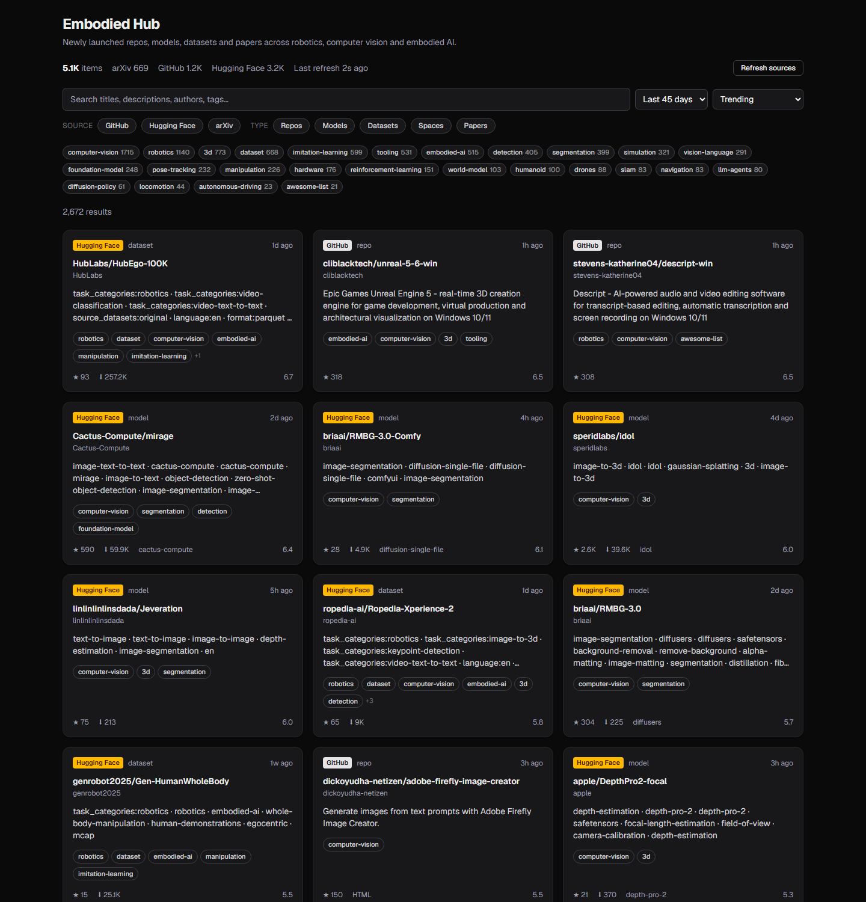
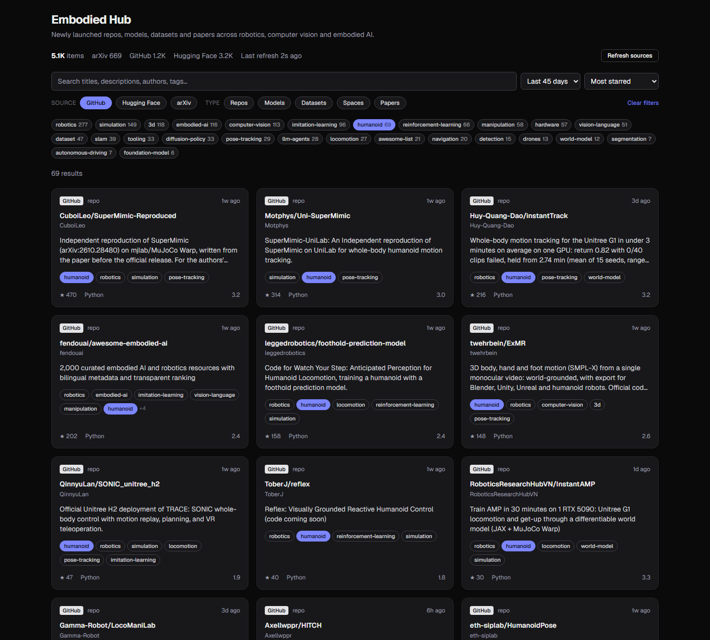
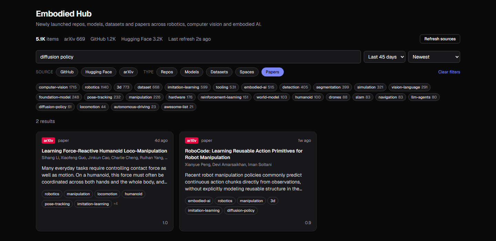

# Embodied Hub

A local discovery hub for people working in robotics, computer vision and embodied AI.
It pulls newly launched repositories, models, datasets, spaces and papers from GitHub,
Hugging Face and arXiv, tags them with a shared taxonomy, scores them by freshness and
popularity, and shows everything in one searchable, filterable feed.

```
Innovation/
├── backend/    FastAPI + SQLite (SQLModel). Fetchers, tagging, scoring, REST API.
├── frontend/   Next.js 16 + Tailwind. The feed UI; proxies /api/* to the backend.
└── dev.ps1     Starts both servers in separate PowerShell windows.
```

## Screenshots

The feed on first load: stats bar, search, source and type filters, tag cloud and ranked cards.



Filters live in the URL, so a view like *GitHub repos tagged humanoid, most starred* is shareable:



Full-text search across titles, abstracts, authors and tags, here limited to papers:



## Prerequisites

- Python 3.12 with [uv](https://docs.astral.sh/uv/) (or plain pip)
- Node.js 20+ with npm
- Optional: the GitHub CLI logged in (`gh auth login`), or a `HUB_GITHUB_TOKEN`, to raise the
  GitHub search limit from 10 to 30 requests per minute. Without a token the first ingest takes
  about three minutes longer.

## Run it

Backend (first time):

```powershell
cd backend
uv venv .venv
uv pip install --python .venv -e ".[dev]"
```

Then, in two terminals:

```powershell
# terminal 1
cd backend
.\.venv\Scripts\Activate.ps1
uvicorn app.main:app --reload --port 8000

# terminal 2
cd frontend
npm install
npm run dev
```

Or run `.\dev.ps1` from the repo root to open both.

- UI: http://localhost:3000
- API docs: http://127.0.0.1:8000/docs

On startup the backend runs a full ingest in the background and then repeats it every
`HUB_REFRESH_HOURS` (default 6). The first run takes a few minutes; the UI shows
"Refreshing…" until it is done and then reloads itself. Press **Refresh sources** to trigger
a run by hand.

## Configuration

Copy `backend/.env.example` to `backend/.env`. Every setting is a `HUB_*` environment variable:

| Variable                 | Default | Meaning                                              |
| ------------------------ | ------- | ---------------------------------------------------- |
| `HUB_LOOKBACK_DAYS`      | 45      | How far back fetchers look for new items             |
| `HUB_REFRESH_HOURS`      | 6       | Interval between automatic refreshes (0 = once only) |
| `HUB_REFRESH_ON_STARTUP` | true    | Run an ingest when the server starts                 |
| `HUB_GITHUB_TOKEN`       | none    | Falls back to `GITHUB_TOKEN`, then `gh auth token`   |
| `HUB_HF_TOKEN`           | none    | Hugging Face token (optional)                        |
| `HUB_DATABASE_URL`       | sqlite in `backend/data/hub.db` | Any SQLAlchemy URL             |

The front end proxies `/api/*` to `API_URL` (default `http://127.0.0.1:8000`); see
`frontend/.env.local.example`.

## API

| Endpoint                     | Purpose                                                                 |
| ---------------------------- | ----------------------------------------------------------------------- |
| `GET /api/items`             | Feed. Filters: `q`, `source`, `kind`, `tag`, `days`, `sort`, `page`     |
| `GET /api/items/{id}`        | One item                                                                |
| `GET /api/tags`              | Tag counts for the current window and sources                           |
| `GET /api/stats`             | Totals per source and kind, last refresh time, whether a run is active  |
| `POST /api/ingest`           | Start a refresh (`?source=github,arxiv` for a subset)                   |
| `GET /api/ingest/runs`       | Recent ingest runs with counts and errors                               |
| `GET /api/ingest/status`     | Whether a run is in progress                                            |

## How items are found

- **GitHub**: for each query in `backend/app/sources/github.py` (topics such as `robotics`,
  `embodied-ai`, `slam`, `gaussian-splatting`, phrases such as "vision-language-action"),
  repositories *created* in the window and popular repositories *pushed* in the window.
- **Hugging Face**: models by pipeline tag (`robotics`, `depth-estimation`, `image-segmentation`,
  ...) and by search (`vla`, `embodied`, `lerobot`), plus robotics datasets and spaces, sorted by
  creation date and by trending score.
- **arXiv**: `cs.RO`, plus `cs.CV`/`cs.LG`/`cs.AI` papers about embodied agents, 3D vision and
  open-vocabulary perception.

Everything is tagged by the keyword taxonomy in `backend/app/tagging.py`, which is also where to
add a new area. Scoring (`backend/app/scoring.py`) multiplies popularity by a 14-day half-life so
new things can outrank old giants.

## Tests

```powershell
cd backend
.\.venv\Scripts\python -m pytest
cd ../frontend
npm run lint
npx tsc --noEmit
```

## Extending

- New source: implement the `Fetcher` protocol in `backend/app/sources/` and register it in
  `FETCHERS` in `backend/app/ingest.py`.
- New area of interest: add queries to the relevant source module and a tag to the taxonomy.
- Roadmap ideas: a try-it playground that runs selected models, saved searches and digests,
  cross-linking papers to their code and models.
